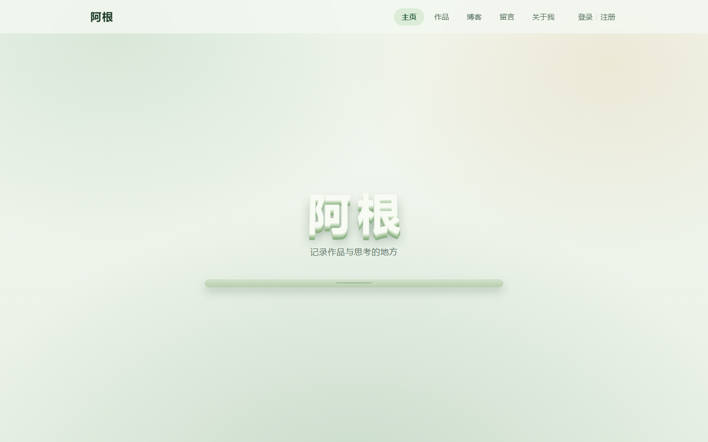
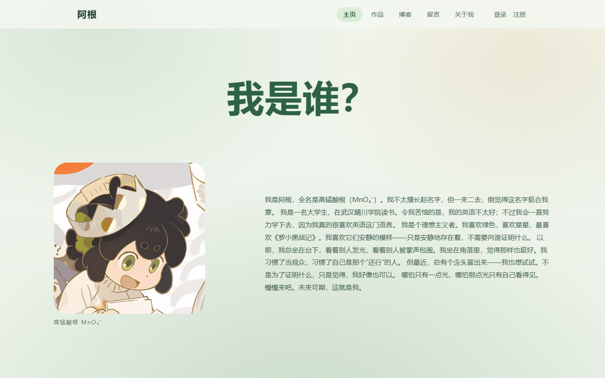
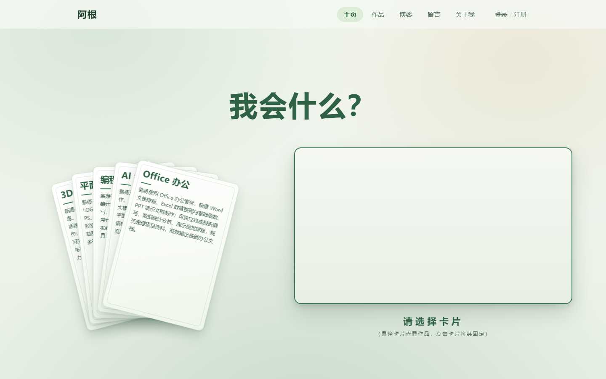
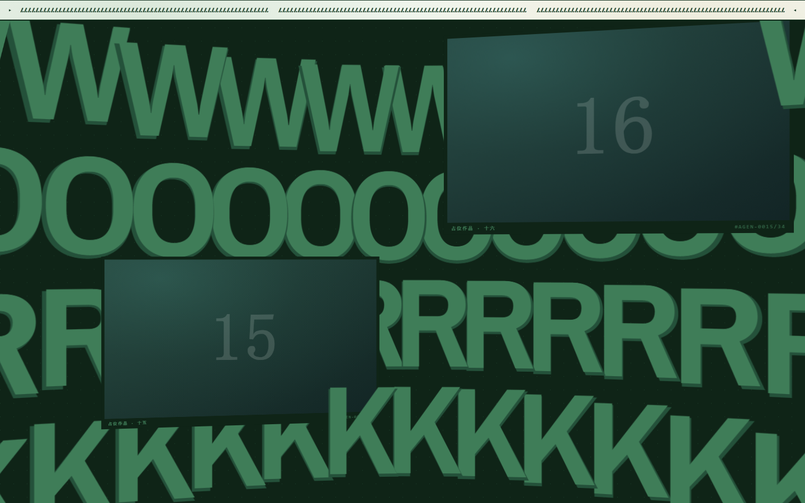
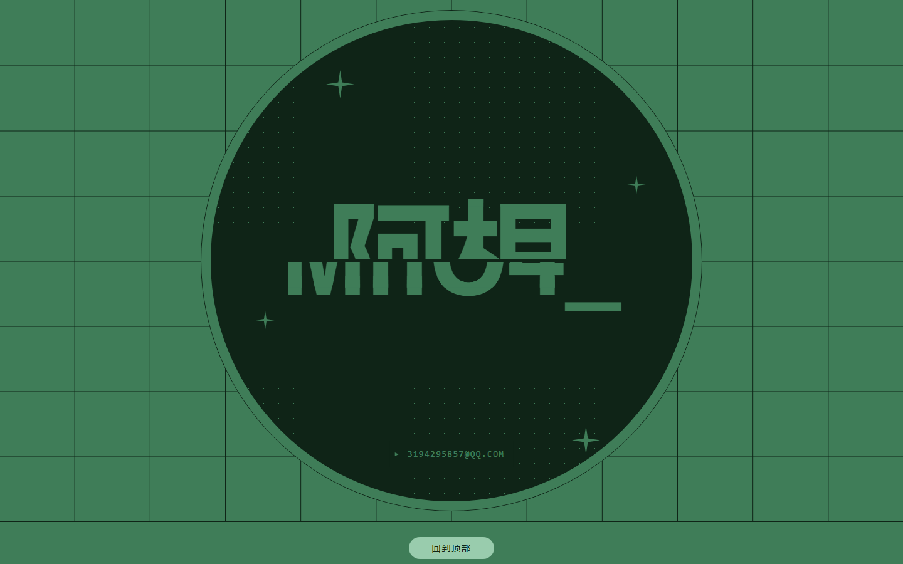

# 阿根 · AGenWebsite

一个不依赖前端框架、用滚动讲故事的个人网站；后面配一套自己写的内容后台。

前端是原生 TypeScript + Canvas，运行时只引了 **GSAP** 与 **Lenis** 两个库；
后端是 Fastify，数据落在 JSON 文件里，**不需要数据库**。



## 它长什么样

整站是**一屏一屏往下滚的叙事**，不是把几个 div 拼起来：

- **首屏**：立体字标带 3D 倾斜与高光挤出，随滚动加大透视、下沉分离并淡出；
  枫叶从上方落下，落到字和地面上会停住，鼠标划过像一阵风把叶子带起来。
- **我是谁**：加高容器 + `sticky` 钉住一屏，头像先被打散成点阵、排成方阵、
  长成像素，再翻面露出照片；正文在「你好！」炸开之后逐字归位。
- **我会什么**：一张牌先被线条一笔一笔画出来，再散成五张扇形卡牌；
  选中某张牌，右侧线框里的粒子团淡换成这张牌的专属场景。
- **作品**：钉住的大字 `WORK`，卡片依次横穿画面，数据来自后端的作品接口。
- **结尾**：`Let's Rock` 圆盘（两行压缩大字 + GO 按钮）与页脚胶囊。

## 截图

| | |
|---|---|
|  |  |
| 我是谁：点阵头像揭示 + 逐字归位的正文 | 我会什么：五张扇形卡牌 + 右侧场景容器 |
|  |  |
| 作品墙：钉住的大字与横穿的卡牌 | 结尾：Let's Rock 圆盘与页脚 |

> 截图由 headless Edge 的 `--screenshot` 配合站内的 URL 钩子拍摄（`?shot=` / `?rm=1` /
> `?wp=` / `?cta=1`），所以画面是确定态、不依赖滚动工具有没有跑起来。

## 技术栈

- **前端**：Vite 6 + 原生 TypeScript（无框架）、Canvas 2D、GSAP 3 + ScrollTrigger、Lenis
- **后端**：Node.js + Fastify 5，JSON 原子写（临时文件 + fsync + rename），无数据库
- **工程**：npm workspaces（`apps/web` / `apps/api`），一条命令同时起前后端
- **后台**：独立构建入口 `/admin.html`（不进公开页面的 bundle、带 `noindex`），
  HMAC 无状态 token 放在 HttpOnly cookie 里；含控制台（SSE 实时日志）、文件管理（白名单
  目录 + 回收站）、作品管理（模板 / 开发者两种模式）

## 目录结构

```
AGenWebsite/
├─ apps/
│  ├─ web/                 # 前端：Vite + 原生 TS
│  │  ├─ index.html        # 主站入口
│  │  ├─ admin.html        # 隐藏的管理后台入口
│  │  └─ src/
│  │     ├─ content/       # 全部文案（换内容只改这里）
│  │     ├─ scene/         # 动画场景（叶子、点阵、卡牌、圆盘…）
│  │     ├─ sections/      # 滚动板块（我是谁 / 我会什么 / 作品 / 结尾）
│  │     ├─ pages/         # 页面（首页装配、作品列表与详情、占位页）
│  │     ├─ components/    # UI 组件（导航栏）
│  │     └─ admin/         # 管理后台（自带 admin.css，不引站内样式）
│  └─ api/                 # 后端：Fastify
│     └─ src/{routes,works,users,admin,media}/
├─ docs/                   # 开发笔记 + README 配图
├─ services/               # 预留：其他语言的服务
└─ .env.example            # 环境变量模板
```

## 快速开始

要求 **Node.js ≥ 20.19**（仓库在 Node 22 / 24 上验证）。

```bash
npm install            # 根目录一次即可，workspaces 会装到各子包
cp .env.example .env   # Windows: copy .env.example .env
npm run dev            # 前端 5173 + 后端 3000
```

打开 <http://localhost:5173>。管理后台在 <http://localhost:5173/admin.html>。

第一个站长账号用 CLI 建（页面上注册出来的一律是普通用户）：

```bash
npm run user:create -- --username yourname --nickname 昵称 --email you@example.com --role owner
```

## 配置

全部变量见 [`.env.example`](.env.example)，最常动的几个：

| 变量 | 作用 |
| --- | --- |
| `PORT` / `WEB_PORT` | 后端（默认 3000）/ 前端（默认 5173） |
| `ADMIN_USER` / `ADMIN_PASSWORD` / `ADMIN_SESSION_SECRET` | 管理后台登录。**三项缺任何一项，`/api/admin/*` 整体返回 503**（fail-closed：忘配应该是打不开门） |
| `USER_SESSION_SECRET` | 访客会话签名密钥；不配会自动生成到 `apps/api/data/.session-secret` |
| `ADMIN_FILE_ROOTS` | 文件管理能碰的目录白名单（`名称=相对路径`） |

运行时数据（`apps/api/data/`：账号、作品、上传的图片、会话密钥）与 `.env` 都不进仓库，
**换机器要重新建账号**。

## 换成自己的内容

下面几样是按「一个人一个站」写死的，克隆下来换成你自己的即可，**代码都不用改**：

- **联系邮箱**：改 `apps/web/src/content/cta.ts` 的 `CTA_EMAIL` 一处就行——圆盘中间的 GO
  按钮与下方那行小字共用这个常量。另外 `apps/web/src/content/auth.ts` 的《用户协议》第七节
  与《隐私政策》第六节正文里各有一处同样的地址，一并替换。
- **头像**：`apps/web/public/portrait-1024.png` 与 `portrait-512.png` 是同一张图的两档尺寸，
  覆盖同名文件即可。**必须正方形且两档一致**（1024×1024 / 512×512）——「我是谁」里的点阵
  是按方图切格的，非方图会让头像变形；原图还要有明暗对比，因为采样规则是「每格保留离该格
  平均色最远的像素」，一片柔光的图点出来会糊成一团。档位表在
  `apps/web/src/pages/home-view.ts` 的 `portraitWidths`（现在是 `[512, 1024]`）。
- **相框素材**：`content/my-way.ts` 与 `content/works.ts` 里的相框都没有 `src`，会按比例画
  一块由主题色派生的版画；往 `public/` 下丢图再补一行 `src` 就换成真图。

## 更多文档

- [docs/DEVELOPMENT.md](docs/DEVELOPMENT.md)：目录细节、各板块的时间线、
  路由与账号体系、后台接口约定、一批「为什么这么做」的踩坑记录。
- [services/README.md](services/README.md)：怎么往这个仓库里加一个别的语言的服务。

## License

[MIT](LICENSE)

## 致谢

视觉与交互的**参考对象**是 [wodniack.dev](https://wodniack.dev)——滚动钉住、卡牌扇形、
圆盘大字这几处结构都是从它那儿学的。本项目是学习性质的重实现，**没有使用它的任何素材**，
所有图形、文案与代码都是自己写的。
